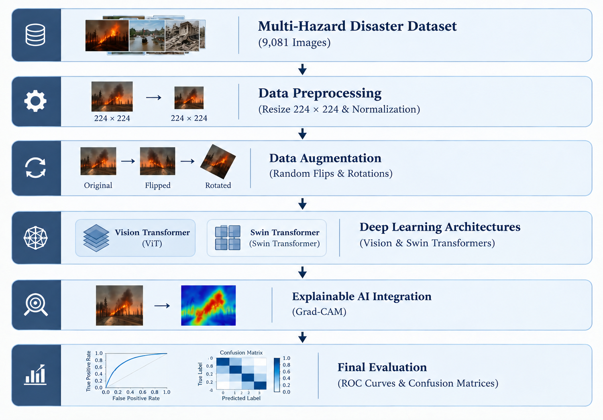
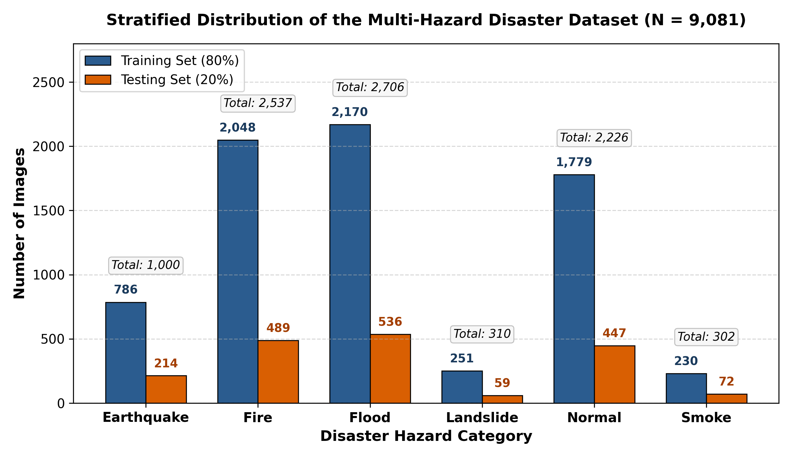
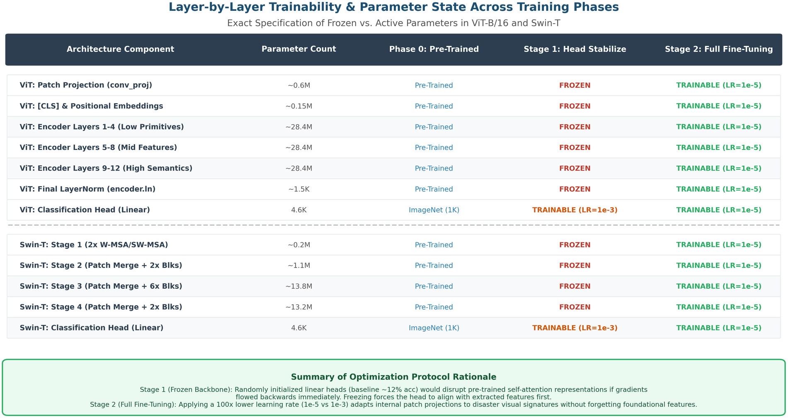
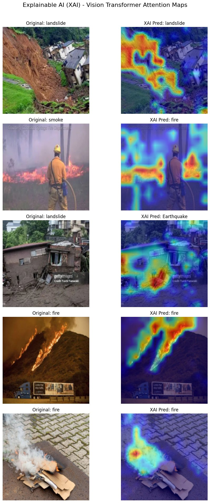

# Deep Learning for Multi-Hazard Scene Recognition: Automated Classification of Natural Disasters from Image Data

[](https://www.python.org/)
[](https://pytorch.org/)
[](https://www.kaggle.com/code/maliswe/disaster-classification-transformers)
[](LICENSE)
[](https://ieeeaccess.ieee.org/)

Official PyTorch implementation and experimental benchmark for the research paper:
> **"Deep Learning for Multi-Hazard Scene Recognition: Automated Classification of Natural Disasters from Image Data"**  
> *Muhammad Ali and Maria Tariq*  
> Department of Computer Science, Lahore Garrison University, Lahore, Pakistan.

---

## 📌 Overview

Rapid situational awareness during extreme natural catastrophes is critical for emergency triage, humanitarian relief, and search-and-rescue operations. This repository provides an automated, explainable multi-hazard disaster classification framework utilizing state-of-the-art **Vision Transformers (ViT-B/16)** and **Hierarchical Shifted-Window Transformers (Swin-T)** benchmarked against four standardized Convolutional Neural Network baselines (**AlexNet**, **VGG-16**, **ResNet-18**, and **GoogLeNet**).



### Key Highlights:
- **Comprehensive Multi-Hazard Scope:** Evaluated on a 9,081-image benchmark spanning six disaster categories: *Earthquake*, *Fire*, *Flood*, *Landslide*, *Normal*, and *Smoke*.
- **Two-Stage Progressive Fine-Tuning:** Linear classification head warmup on frozen representations followed by full-encoder optimization with conservative learning rates ($1 \times 10^{-5}$) to prevent catastrophic forgetting.
- **Explainable AI (XAI) Auditing:** Adapted Gradient-weighted Class Activation Mapping (Grad-CAM) with token-to-grid spatial reshaping ($\mathcal{T}: \mathbb{R}^{B \times 196 \times D} \to \mathbb{R}^{B \times D \times 14 \times 14}$) to visually audit model attention on physical disaster morphology.
- **Life-Critical Imbalance Diagnostics:** Full statistical evaluation tracking Accuracy, Precision, Specificity, False Negative Rate (FNR), Misclassification Rate (MCR), and One-vs-Rest ROC/AUC curves.

---

## 📊 Dataset Distribution

The dataset comprises **9,081 multi-hazard images** partitioned using a stratified 80–20 train-test split:



| Hazard Category | Total Images | Training Set (80%) | Testing Set (20%) |
| :--- | :---: | :---: | :---: |
| **Earthquake** | 1,000 | 786 | 214 |
| **Fire** | 2,537 | 2,048 | 489 |
| **Flood** | 2,706 | 2,170 | 536 |
| **Landslide** | 310 | 251 | 59 |
| **Normal** | 2,226 | 1,779 | 447 |
| **Smoke** | 302 | 230 | 72 |
| **Total** | **9,081** | **7,264** | **1,817** |

*Dataset Source:* Publicly available on Kaggle ([Disaster Classification Dataset](https://www.kaggle.com/code/maliswe/disaster-classification-transformers)).

---

## 🔬 Progressive Transfer Learning Strategy

To preserve pre-trained feature hierarchies on moderate-scale disaster imagery, training follows a two-stage protocol:



1. **Stage 1 (Feature Extraction with Frozen Backbone):** All encoder weights are frozen ($\text{requires\_grad} = \text{False}$). A randomly initialized 6-class linear projection head trains for 2 epochs under Adam ($\text{LR} = 1 \times 10^{-3}$).
2. **Stage 2 (Full Model Fine-Tuning):** All encoder blocks unfreeze and train end-to-end for 3 epochs with a conservative learning rate ($\text{LR} = 1 \times 10^{-5}$).

---

## 📈 Benchmark Results

All six architectures were evaluated under identical experimental conditions (80–20 stratified split, batch size 32, input resolution $224 \times 224$, 5 epochs):

### Architectural Comparison on Held-Out Test Set (N = 1,817)

| Model | Architecture Paradigm | Parameters | Test Loss | Accuracy (%) | Macro Prec. (%) | Macro Rec. (%) | Macro F1 (%) |
| :--- | :--- | :---: | :---: | :---: | :---: | :---: | :---: |
| **AlexNet** | Classical 8-Layer CNN | 61.1M | 0.2265 | 94.33 | 93.62 | 88.64 | 90.72 |
| **VGG-16** | Deep Plain CNN ($3\times 3$) | 138.4M | 0.2642 | 94.61 | 94.67 | 88.02 | 90.75 |
| **ResNet-18** | Residual CNN (Skip Conns) | 11.7M | 0.1541 | 95.98 | 94.59 | 92.30 | 93.30 |
| **GoogLeNet** | Multi-Scale Inception CNN | 6.6M | 0.1301 | 96.53 | 96.12 | 92.80 | 94.26 |
| **ViT-B/16 (Ours)** | Global Self-Attention Transformer | 85.8M | 0.0747 | 97.91 | **97.76** | 95.12 | 96.32 |
| **Swin-T (Ours)** | Shifted-Window Transformer | **27.5M** | **0.0654** | **98.46** | 97.73 | **95.19** | **96.37** |

---

## 🔍 Explainable AI (XAI) Visual Grounding

Spatial attention maps generated via Grad-CAM verify that the self-attention mechanism localizes genuine disaster damage morphology (active fire fronts, collapsed masonry, submerged roadways) rather than superficial contextual noise:



---

## 🚀 Quickstart & Reproduction

### 1. Clone the Repository
```bash
git clone https://github.com/m-ali-swe/multi-hazard-scene-recognition.git
cd multi-hazard-scene-recognition
```

### 2. Environment Setup
```bash
# Create virtual environment (optional)
python -m venv venv
source venv/bin/activate  # On Windows: venv\Scripts\activate

# Install dependencies
pip install -r requirements.txt
```

### 3. Notebooks Directory
The `notebooks/` directory contains self-contained, reproducible Jupyter notebooks for all evaluated pipelines:
- [`disaster-classification-transformers.ipynb`](notebooks/disaster-classification-transformers.ipynb): Primary pipeline for ViT-B/16 and Swin-T training, evaluation, ROC curves, and Grad-CAM generation.
- [`alexnet-googlenet-baselines.ipynb`](notebooks/alexnet-googlenet-baselines.ipynb): Convolutional baselines for AlexNet and GoogLeNet.
- [`disaster-classification-vgg16-cnn-baseline.ipynb`](notebooks/disaster-classification-vgg16-cnn-baseline.ipynb): VGG-16 baseline training and metrics.
- [`disaster-scene-classification-resnet18-cnn.ipynb`](notebooks/disaster-scene-classification-resnet18-cnn.ipynb): ResNet-18 residual baseline training and metrics.

> 💡 **Cloud Execution:** You can also run the complete transformer pipeline directly in your browser on Kaggle with free GPU acceleration:  
> 👉 [Open Kaggle Notebook](https://www.kaggle.com/code/maliswe/disaster-classification-transformers)

---

## 📂 Repository Structure

```
multi-hazard-scene-recognition/
├── images/
│   ├── dataset_distribution.png
│   ├── layer_freezing_comparison_matrix.png
│   ├── pipeline.jpg
│   ├── sota_comparison.png
│   └── xai_heatmap.jpg
├── notebooks/
│   ├── alexnet-googlenet-baselines.ipynb
│   ├── disaster-classification-transformers.ipynb
│   ├── disaster-classification-vgg16-cnn-baseline.ipynb
│   └── disaster-scene-classification-resnet18-cnn.ipynb
├── .gitignore
├── LICENSE
├── README.md
└── requirements.txt
```

---

## 📜 Citation

If you find this research, dataset benchmark, or code useful in your work, please cite our paper:

```bibtex
@article{ali2026multihazard,
  title={Deep Learning for Multi-Hazard Scene Recognition: Automated Classification of Natural Disasters from Image Data},
  author={Ali, Muhammad and Tariq, Maria},
  journal={IEEE Access},
  year={2026},
  note={Under Peer Review}
}
```

---

## ⚖️ License

This project is licensed under the MIT License - see the [LICENSE](LICENSE) file for details.
